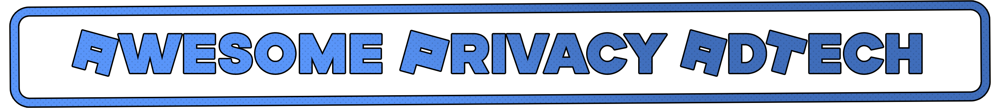

 <!-- -SVG-Line- -->

**Open-source consent tooling, normative specifications, and privacy-enhancing technologies for engineers building ad-funded products that respect users.**

> Each entry is marked with the kind of resource it is:  open-source repository,  documentation, specification, or hosted tool. Dormant and archived projects are kept when they still explain an architecture — they are labeled as such.

---

A curated map of the privacy engineering surface for advertising systems: self-hostable CMPs, the IAB and W3C signals that carry user choice, the browser APIs that replaced (or failed to replace) third-party cookies, and the cryptographic machinery now used to compute on data nobody is allowed to see.

**Scope.** Preference is given to code you can run, specifications you can implement against, and reference implementations published by the standards bodies themselves. Purely commercial SaaS platforms are deliberately excluded, since what they publish is positioning rather than a mechanism you can inspect or implement.

**Currency note (November 2026).** This landscape moves fast and several long-standing assumptions no longer hold. Chrome has **deprecated and removed** Attribution Reporting, Protected Audience, Topics, Shared Storage, Private Aggregation, and Related Website Sets, and is phasing out Fenced Frames; the entries below are labelled accordingly because the designs remain the reference material for the wider industry. IAB Tech Lab renamed the **Global Privacy Platform** the **Global Privacy Protocol** (both abbreviated GPP) and renamed **Seller Defined Audiences** to **Curated Audiences**, while Apple's **Private Click Measurement** is now shipped as **Web AdAttributionKit**. Two mechanisms standardised outside that stack now matter on their own terms: **Privacy Pass** has an active IETF working group with several open clients and issuers, and **Oblivious HTTP** was published as **RFC 9458**; both are collected in section 7.

**Legend:**  GitHub resource ·  website or published document.

## Table of Contents

- [1. Open-Source Consent Management Platforms (CMPs)](#1-open-source-consent-management-platforms-cmps)
- [2. Consent & Privacy Standards](#2-consent--privacy-standards)
- [3. Browser Privacy & Sandbox APIs](#3-browser-privacy--sandbox-apis)
- [4. Privacy-Enhancing Technologies (PETs) & Clean Rooms](#4-privacy-enhancing-technologies-pets--clean-rooms)
- [5. Alternative Identifiers & Cookieless Specs](#5-alternative-identifiers--cookieless-specs)
- [6. Auditing, Debugging & Compliance Tools](#6-auditing-debugging--compliance-tools)
- [7. Anonymous Credentials, Tokens and Oblivious Transport](#7-anonymous-credentials-tokens-and-oblivious-transport)
- [8. Technical Reading & Working Groups](#8-technical-reading--working-groups)
- [Contributing](#contributing)
- [License](#license)

---

## 1. Open-Source Consent Management Platforms (CMPs)

*Self-hostable consent tools and UI components for collecting preferences and controlling scripts. Framework registration and deployment configuration are separate steps.*

### Consent Interfaces and Script Gating

 [Klaro](https://github.com/kiprotect/klaro) - Consent manager that rewrites third-party script tags into inert placeholders and only materialises them after per-service opt-in.

 [Orejime](https://github.com/empreinte-digitale/orejime) - Klaro-derived consent manager rebuilt around WCAG and French RGAA accessibility, with fully keyboard-navigable and screen-reader-announced dialogs.

 [CookieConsent](https://github.com/orestbida/cookieconsent) - Dependency-free vanilla-JS consent plugin providing granular per-category preferences, multi-language UI, and a documented pre-consent script-blocking API.

 [c15t](https://github.com/c15t/c15t) - Headless consent infrastructure for React, Next.js, and Vue with first-class IAB TCF and Google Consent Mode v2 adapters.

 [tarteaucitron.js](https://github.com/AmauriC/tarteaucitron.js) - Service-level consent manager that maps each third-party widget to its own toggle and supports Google Consent Mode v2.

 [Osano CookieConsent](https://github.com/osano/cookieconsent) - The long-maintained cookieconsent.js library for a compact EU/GDPR notice with theming and opt-in or opt-out modes.

 [Silktide Consent Manager](https://github.com/silktide/consent-manager) - MIT-licensed banner driven by a JSON configuration and paired with a script-blocking layer that runs before consent.

 [react-cookie-consent](https://github.com/Mastermindzh/react-cookie-consent) - Minimal cookie consent bar for React applications, useful as a UI primitive rather than a complete compliance layer.

 [libreconsent](https://github.com/nicolasestrem/libreconsent) - Self-hosted consent library with tag gating, Google Consent Mode v2, and a read-only bridge to external TCF CMPs.

 [Consenti](https://github.com/santoshe61/consenti) - Self-hosted consent toolkit with a frontend widget, optional backend, and partial TCF and GPP support.

### Self-Hosted Consent Backends

 [68publishers Consent Management Platform](https://github.com/68publishers/consent-management-platform) - Standalone service that stores per-visitor cookie consents, crawls a site to propose cookie definitions, and reports consent statistics, paired with a front-end widget.

 [Conzent OCI](https://github.com/conzent-net/oci) - Apache-2.0 self-hosted core of the Conzent CMP: banner, cookie scanner, consent log, IAB TCF v2.4 output, and Consent Mode v2 signals.

 [ConsentOS](https://github.com/ConsentOS/consentos) - Multi-tenant self-hosted CMP with script and cookie auto-blocking, Playwright-driven cookie scanning, TCF and GPP output, and an audit trail of consent records; source-available under the Elastic Licence 2.0 rather than an OSI licence.

 [AppNexus CMP reference implementation](https://github.com/appnexus/cmp) - Dormant Xandr reference CMP showing how a TCF-era banner obtains, persists, and re-exposes consent; kept as an architectural sample rather than a maintained product.

### Framework and CMS Integrations

 [django-cookie-consent](https://github.com/django-commons/django-cookie-consent) - Reusable Django application that defines cookie groups, stores a versioned consent decision per visitor, and gates template tags on the recorded choice.

 [68publishers CookieConsent](https://github.com/68publishers/cookie-consent) - Latte and Nette cookie bar with change tracking, Google Tag Manager and Consent Mode integration, and a bridge to the companion CMP backend.

 [Laravel Cookie Consent](https://github.com/devrabiul/laravel-cookie-consent) - Laravel package that renders a configurable consent banner and persists the visitor's decision so views and scripts can be gated on it.

 [Wagtail Tag Manager](https://github.com/jberghoef/wagtail-tag-manager) - Wagtail add-on combining a tag manager for third-party snippets with a cookie bar that holds each snippet back until its category is accepted.

 [REDAXO consent_manager](https://github.com/FriendsOfREDAXO/consent_manager) - Opt-in service consent banner for the REDAXO CMS with per-service toggles, consent logging, and a backend for maintaining texts and service definitions.

 [FAZ Cookie Manager](https://github.com/fabiodalez-dev/FAZ-Cookie-Manager) - WordPress consent plugin with a browser-side cookie scanner, consent log, Google Consent Mode v2 and IAB TCF v2.3 output, distributed as a cloud-free fork.

 [Porsche Cookie Consent Banner](https://github.com/porscheofficial/cookie-consent-banner) - MIT-licensed consent banner distributed as a Web Component and a React component, with a category model, local storage of the decision, and an event-based API.

 [Consent Banner JS](https://github.com/tagconcierge/consent-banner-js) - Roughly 3 kB dependency-free banner that is CMP-agnostic and can emit Google Consent Mode states before any tag loads.

### Mobile and In-App Consent

 [auto-app-consent](https://github.com/TrackerControl/auto-app-consent) - Android library that writes IAB TCF v2.2 and US Privacy strings into SharedPreferences and uses Gradle bytecode transforms to block ad-SDK calls until consent exists.

 [Sourcepoint iOS CMP](https://github.com/SourcePointUSA/ios-cmp-app) - Reference iOS app integrating a native consent message, useful for seeing how CMP dialogs and consent callbacks work outside a WebView.

 [Sourcepoint Android CMP](https://github.com/SourcePointUSA/android-cmp-app) - Android counterpart showing message rendering, per-vendor consent state, and callback handling for in-app ad SDKs.

 [Smartlook Android consent SDK](https://github.com/smartlook/android-consent-sdk) - Configurable consent SDK that collects purpose-level analytics consent before an app initialises recording or tracking SDKs.

## 2. Consent & Privacy Standards

*The wire formats and in-page APIs that carry consent between publishers, CMPs, and vendors. If you are decoding a string in a bid request, the normative text lives here.*

### IAB TCF — Transparency & Consent Framework

 [IAB Europe TCF](https://iabeurope.eu/transparency-consent-framework/) - Governance home for the framework, currently v2.3, which makes the Disclosed Vendors segment mandatory to resolve legitimate-interest disclosure ambiguity.

 [TCF technical specifications](https://github.com/InteractiveAdvertisingBureau/GDPR-Transparency-and-Consent-Framework) - Normative TC String encoding, CMP API (`__tcfapi`), Global Vendor List, and Global CMP List formats maintained by IAB Tech Lab.

 [iabtcf-es](https://github.com/InteractiveAdvertisingBureau/iabtcf-es) - Official TypeScript TC String encoder/decoder plus the CMP API shim and GVL tooling that most registered CMPs are built on.

 [iabtcf-java](https://github.com/InteractiveAdvertisingBureau/iabtcf-java) - JVM implementation of TC String encoding and decoding for server-side bidstream processing.

 [iabconsent](https://github.com/LiveRamp/iabconsent) - Go parser for TCF v1.1 and v2 strings, convenient for high-throughput bidder and SSP pipelines.

 [Consent String SDK for PHP](https://github.com/mifefr/consent-string-sdk-php) - PHP encoder and decoder for TCF v1.1 and v2 strings, for validating consent server-side in PHP stacks.

 [iab-tcf (Python)](https://github.com/gguridi/iab-tcf) - Python implementation of the TCF consent-string formats with encode and decode support for v1.1 and v2.

 [TCF v1.1 Consent String SDK](https://github.com/InteractiveAdvertisingBureau/Consent-String-SDK-JS) - IAB's original JavaScript consent-string SDK; superseded by iabtcf-es, but still the reference for decoding v1.1-era traffic.

### Global Privacy Protocol (GPP)

 [Global Privacy Protocol specification](https://github.com/InteractiveAdvertisingBureau/Global-Privacy-Platform) - IAB Tech Lab multiplexing spec that carries TCF-EU, TCF-CA, the MSPA US National string, and individual state privacy strings in one payload via `__gpp`.

 [GPP section registry](https://github.com/InteractiveAdvertisingBureau/Global-Privacy-Platform/tree/main/Sections) - Canonical per-jurisdiction string definitions, the file to diff when a new state law lands.

 [iabgpp-es](https://github.com/IABTechLab/iabgpp-es) - TypeScript GPP encoder/decoder and CMP API implementation for the v1.1 callback-based interface.

 [iabgpp-java](https://github.com/IABTechLab/iabgpp-java) - Java counterpart for GPP string encoding and decoding.

 [iabgpp-rs](https://github.com/noirotm/iabgpp-rs) - Community Rust implementation of GPP string parsing for latency-sensitive services.

 [go-gpp](https://github.com/prebid/go-gpp) - Go library for parsing IAB Global Privacy Protocol strings used by Prebid Server.

 [gppstring](https://github.com/Paginar/gppstring) - PHP client library for constructing IAB GPP strings across the supported US state sections.

### Global Privacy Control (GPC)

 [Global Privacy Control specification](https://www.w3.org/TR/gpc/) - W3C Working Draft defining the `Sec-GPC` request header and the `navigator.globalPrivacyControl` DOM property as an enforceable opt-out-of-sale-and-sharing signal.

 [w3c/gpc](https://github.com/w3c/gpc) - Editor's draft, explainer, and issue tracker for GPC, now a W3C Privacy Working Group standards-track item.

 [globalprivacycontrol.org](https://globalprivacycontrol.org/) - Implementer-facing home for GPC with browser and extension support status plus a reference server to test against.

### US State Privacy, Deletion and Accountability

 [US Privacy (CCPA) specification](https://github.com/InteractiveAdvertisingBureau/USPrivacy) - The `__uspapi` string format and API that preceded GPP in US bid requests, still encountered in legacy traffic.

 [Data Deletion Request Framework](https://github.com/InteractiveAdvertisingBureau/Data-Subject-Rights) - IAB Tech Lab specification for propagating deletion and opt-out requests across the supply chain instead of leaving each vendor to interpret them.

 [Accountability Platform](https://github.com/InteractiveAdvertisingBureau/Accountability-Platform) - Specification and schemas for the transparency reporting that underpins signatory compliance claims.

### Consent Mode and Tag-Level Signals

 [Consent mode for websites](https://developers.google.com/tag-platform/security/guides/consent) - Google's interface definition for default and updated consent state, including the v2 `ad_user_data` and `ad_personalization` signals that most CMPs now emit.

 [Consent mode for apps](https://developers.google.com/tag-platform/security/guides/app-consent) - App-side equivalent for Firebase and Google Analytics, with default consent declared in `info.plist` and updated through `setConsent`.

 [GTM consent mode examples](https://github.com/googleanalytics/gtm-consent-mode-examples) - Archived Google samples contrasting basic and advanced consent mode inside Tag Manager containers.

### Legacy and Retired Signals

 [Do Not Track specification](https://www.w3.org/TR/tracking-dnt/) - The retired W3C `DNT` header and `navigator.doNotTrack` work, retained because the values still appear in traffic and in compliance documentation.

 [W3C DNT archive](https://github.com/w3c/dnt) - Archived editor's drafts and issue history for Do Not Track, useful when tracing why the signal was abandoned.

## 3. Browser Privacy & Sandbox APIs

*What browsers actually enforce. Note that the Chrome ad-targeting stack was largely deprecated in 2025–2026, so these entries matter both as live implementation targets and as the documentary record of an architectural direction the industry abandoned.*

### Chrome Privacy Sandbox

 [Privacy Sandbox overview](https://privacysandbox.google.com/) - Entry point to the API portfolio, now fronted by an explicit notice that several technologies are being phased out.

 [Privacy Sandbox feature status](https://privacysandbox.google.com/overview/status) - Authoritative, continuously updated lifecycle table for every API — read this before designing against any of them.

 [Protected Audience API](https://privacysandbox.google.com/private-advertising/protected-audience) - On-device interest-group auctions intended to serve remarketing without cross-site identifiers, deprecated and removed from Chrome.

 [TURTLEDOVE / FLEDGE explainer](https://github.com/WICG/turtledove) - Archived WICG design for in-browser ad auctions that was later specified as Protected Audience.

 [Topics API](https://privacysandbox.google.com/private-advertising/topics) - Epoch-based, taxonomy-limited interest signal exposed through `document.browsingTopics()` and `Sec-Browsing-Topics`, deprecated and removed.

 [Attribution Reporting API](https://github.com/WICG/attribution-reporting-api) - Archived proposal for event-level and aggregatable conversion reports, deprecated in Chrome.

 [Aggregation Service](https://github.com/privacysandbox/aggregation-service) - TEE-hosted service that batches, decrypts, and noisily aggregates summary reports so no single operator sees both input and output.

 [Fenced Frames](https://github.com/WICG/fenced-frame) - Embedding primitive that isolates ad content from the embedding page's DOM and storage, scheduled for removal.

 [Topics API explainer](https://github.com/patcg-individual-drafts/topics) - Archived explainer for the epoch-based interest taxonomy exposed through `document.browsingTopics()`, removed from Chrome.

 [Private Aggregation API explainer](https://github.com/patcg-individual-drafts/private-aggregation-api) - Archived explainer for the aggregate-only reporting surface that outlived most of the surrounding stack.

 [Shared Storage explainer](https://github.com/WICG/shared-storage) - Archived proposal for unpartitioned cross-site storage behind a worklet API, removed with the rest of the ad-targeting stack.

 [Privacy Sandbox demos](https://github.com/privacysandbox/privacy-sandbox-demos) - Archived end-to-end demo environment for the Sandbox APIs, still the quickest way to see the intended request flows.

 [Privacy Sandbox web playbook](https://github.com/privacysandbox/privacy-sandbox-web-playbook) - Archived implementation playbook covering enrolment, API selection, and performance trade-offs for publishers.

 [Privacy Sandbox attestations](https://github.com/privacysandbox/attestation) - Archived documentation of the developer enrolment and attestation requirements that gated API access.

### Browser Attribution Proposals

 [Attribution Level 1](https://www.w3.org/TR/privacy-preserving-attribution/) - W3C working draft for aggregate advertising attribution using distributed aggregation and differential privacy.

 [Attribution use cases](https://github.com/InteractiveAdvertisingBureau/Attribution-Use-Cases) - IAB Tech Lab catalogue of measurement use cases that emerging attribution APIs are expected to satisfy.

### Partitioned Storage (cross-browser specs)

 [CHIPS](https://github.com/privacycg/CHIPS) - The `Partitioned` cookie attribute, which keys storage by top-level site to block cross-site rejoining while preserving embedded flows, shipped in Chrome and adopted by WebKit's cookie policy.

 [Storage Access API](https://github.com/privacycg/storage-access) - Spec letting embedded frames request access to their first-party cookies under an explicit user gesture, implemented in Chrome, Safari, and Firefox.

 [Client-Side Storage Partitioning](https://github.com/privacycg/storage-partitioning) - Privacy CG specification describing how storage keys are scoped by top-level site and which embed flows are excluded.

 [Storage Access API for non-cookie storage](https://github.com/privacycg/saa-non-cookie-storage) - Work item extending Storage Access API permissions beyond cookies to the rest of client-side storage.

 [Navigation-based Tracking Mitigations](https://github.com/privacycg/nav-tracking-mitigations) - Explainer covering bounce-tracking defences, the mechanism behind redirect-based tracker stripping in Safari and Firefox.

 [First-Party Sets](https://github.com/WICG/first-party-sets) - Archived explanation of the related-domain set model that Chrome dropped alongside third-party cookie deprecation.

 [IsLoggedIn API](https://github.com/privacycg/is-logged-in) - Proposal for a browser-mediated login-state API whose discussion stopped in 2023; relevant to why login detection stayed fragmented.

### Safari and WebKit

 [Tracking Prevention in WebKit](https://webkit.org/tracking-prevention/) - Implementation-level description of ITP, including partitioned storage, the script-writable storage cap, and bounce-tracking defences.

 [Introducing Private Click Measurement](https://webkit.org/blog/11529/introducing-private-click-measurement-pcm/) - Design rationale for 8-bit source and 4-bit trigger attribution with a randomised 24–48 hour reporting delay.

 [Private Click Measurement specification](https://github.com/privacycg/private-click-measurement) - Privacy Community Group work item defining the attribution wire format and the `.well-known` trigger endpoints.

 [Private Browsing 2.0](https://webkit.org/blog/15697/private-browsing-2-0/) - Documents Web AdAttributionKit in Private Browsing, link tracking parameter stripping, and partitioned session storage.

 [AdAttributionKit](https://developer.apple.com/app-store/ad-attribution/) - Apple's app install and re-engagement attribution framework, using crowd-anonymity tiers to gate postback detail.

 [WebKit explainers](https://github.com/WebKit/explainers) - WebKit's repository of design explainers, including the storage-access, tracking-prevention, and attribution proposals that became shipping behaviour.

### Firefox

 [Multi-Account Containers](https://github.com/mozilla/multi-account-containers) - Firefox extension that partitions cookies and site data per container, a user-controlled analogue of first-party-set storage isolation.

### DuckDuckGo and Brave

 [DuckDuckGo privacy configuration](https://github.com/duckduckgo/privacy-configuration) - Remote configuration that switches individual protections in DuckDuckGo's apps and extensions, a public view of shipping privacy policy expressed as data.

 [Brave browser core](https://github.com/brave/brave-core) - Chromium fork where Brave's Shields, fingerprint randomisation, and ad-block engine integration are implemented.

### Mobile Platform Requirements

 [App Tracking Transparency](https://developer.apple.com/app-store/user-privacy-and-data-use/) - Apple's requirements for cross-app tracking permission, including the usage-description string and the IDFA rules that reshaped mobile attribution.

 [Privacy manifest files](https://developer.apple.com/documentation/bundleresources/privacy-manifest-files) - The `PrivacyInfo.xcprivacy` format through which apps and SDKs declare collected data, tracking domains, and required-reason API usage.

## 4. Privacy-Enhancing Technologies (PETs) & Clean Rooms

*The cryptographic and statistical substrate for computing aggregate answers over data that never leaves its owner's boundary.*

### Differential Privacy

 [Google Differential Privacy](https://github.com/google/differential-privacy) - Production C++, Go, and Java libraries implementing Laplace and Gaussian mechanisms with rigorous privacy budget accounting.

 [OpenDP](https://github.com/opendp/opendp) - Rust core with Python bindings exposing composable transformations and measurements under a formal privacy framework.

 [SmartNoise SDK](https://github.com/opendp/smartnoise-sdk) - Differentially private query layer for SQL and Spark workloads with a policy-driven privacy accountant.

 [Tumult Analytics](https://github.com/opendp/tumult-analytics) - Python library for privately computing aggregate queries on tabular data with explicit privacy loss tracking.

 [Diffprivlib](https://github.com/IBM/differential-privacy-library) - IBM's scikit-learn-compatible library bringing DP guarantees to common ML estimators and statistics.

 [TensorFlow Privacy](https://github.com/tensorflow/privacy) - DP-SGD optimizers and privacy accounting for training models without memorising individual records.

 [PyDP](https://github.com/OpenMined/PyDP) - Python bindings over Google's C++ DP library for analysts who do not want to touch C++.

 [Opacus](https://github.com/meta-pytorch/opacus) - PyTorch library for training models with differential privacy.

 [PipelineDP](https://github.com/OpenMined/PipelineDP) - Python framework for differentially private aggregations on batch processing systems including Apache Beam and Spark.

 [SQL Differential Privacy](https://github.com/uber-archive/sql-differential-privacy) - Deprecated Uber project that inferred sensitivity from SQL dataflows and rewrote queries to add noise; a clear worked example of differential privacy at the query layer.

### Secure Multiparty Computation

 [MP-SPDZ](https://github.com/data61/MP-SPDZ) - Multi-protocol framework spanning arithmetic, binary, and garbled-circuit protocols with a common high-level language.

 [MOTION](https://github.com/encryptogroup/MOTION) - C++ MPC framework with a modular front end for composing mixed-protocol two-party and multi-party computations.

 [SecretFlow](https://github.com/secretflow/secretflow) - Unified Python framework combining MPC, TEE, and federated learning under one programming model.

 [libscapi](https://github.com/cryptobiu/libscapi) - Comprehensive C++ library of secure two-party and multi-party computation protocols and primitives.

 [MPZ](https://github.com/privacy-scaling-explorations/mpz) - Rust library of maliciously secure two-party and three-party MPC primitives designed for embedded use.

 [emp-toolkit](https://github.com/emp-toolkit/emp-tool) - Toolkit of efficient two-party primitives, including oblivious transfer and garbled circuits, that many research MPC prototypes build on.

 [emp-sh2pc](https://github.com/emp-toolkit/emp-sh2pc) - Semi-honest two-party computation built on garbled circuits, exposing a small C++ API for defining circuits.

 [MPyC](https://github.com/lschoe/mpyc) - Python framework for honest-majority MPC with syntax close to ordinary Python, widely used for teaching and prototyping.

 [JIFF](https://github.com/multiparty/jiff) - JavaScript MPC library for browser-based computation, with secret-sharing protocols and a runtime that coordinates parties.

 [SPDZ-2](https://github.com/bristolcrypto/SPDZ-2) - Archived SPDZ and MASCOT implementation; the offline/online phase split it established is still the reference design.

 [TF Encrypted](https://github.com/tf-encrypted/tf-encrypted) - Framework for encrypted machine learning on TensorFlow, dormant since 2024 but a useful record of the MPC-for-inference pattern.

 [SPU](https://github.com/secretflow/spu) - SecretFlow's secure processing unit, a compiler and runtime that turns Python data programs into MPC protocols.

 [HEU](https://github.com/secretflow/heu) - High-performance homomorphic encryption library from SecretFlow covering several partially homomorphic schemes.

 [Carbyne Stack](https://github.com/carbynestack/carbynestack) - Cloud-native MPC stack that packages secret-sharing protocols as Kubernetes services.

### Private Set Intersection

 [OpenMined PSI](https://github.com/OpenMined/PSI) - ECDH plus Bloom filter private set intersection cardinality protocol with C++, Go, and Python bindings.

 [libPSI](https://github.com/osu-crypto/libPSI) - Research-grade PSI and private set union protocols built for very large input sets.

 [SecretFlow PSI](https://github.com/secretflow/psi) - PSI and private information retrieval implementations extracted from the SecretFlow project.

 [Private Join and Compute](https://github.com/google/private-join-and-compute) - Cryptographic protocol implementation for calculating aggregate statistics over the intersection of two private datasets.

 [APSI](https://github.com/microsoft/APSI) - Microsoft's asymmetric PSI library for labelled and unlabelled sets, where the sender's set may be far larger than the receiver's.

 [libOTe](https://github.com/osu-crypto/libOTe) - Fast oblivious-transfer extension library that underpins most modern PSI and MPC implementations.

 [encryptogroup PSI](https://github.com/encryptogroup/PSI) - Collection of PSI protocol implementations spanning OT-based and homomorphic approaches.

 [VOLE-PSI](https://github.com/Visa-Research/volepsi) - Archived VOLE-based PSI from Visa Research, one of the fastest published designs for unbalanced sets.

 [MultipartyPSI](https://github.com/osu-crypto/MultipartyPSI) - Practical multi-party PSI from symmetric-key techniques, for matches that involve more than two advertisers.

 [SealPIR](https://github.com/microsoft/SealPIR) - Reference implementation of single-server private information retrieval over SEAL, the complement to PSI when one side only needs lookups.

 [PrivacyGo](https://github.com/tiktok-privacy-innovation/PrivacyGo) - TikTok's published collection of PET building blocks, including PSI variants and secure computation primitives, framed around advertising use cases.

### Trusted Execution and Encryption

 [Microsoft SEAL](https://github.com/microsoft/SEAL) - Homomorphic encryption library implementing the BFV and CKKS schemes for arithmetic directly on ciphertext.

 [Confidential Consortium Framework](https://github.com/microsoft/CCF) - Framework for building attested, ledger-backed confidential services inside hardware enclaves.

 [Open Enclave SDK](https://github.com/openenclave/openenclave) - Portable, vendor-neutral enclave abstraction for writing TEE applications once and running them across platforms.

 [OpenFHE](https://github.com/openfheorg/openfhe-development) - C++ library implementing homomorphic encryption schemes and operations on encrypted data.

 [TenSEAL](https://github.com/OpenMined/TenSEAL) - Python library for homomorphic encryption operations on tensors using Microsoft SEAL.

 [Apache Teaclave](https://github.com/apache/teaclave) - Platform for confidential computing on sensitive data using trusted execution environments.

 [EGo](https://github.com/edgelesssys/ego) - SDK for building Go confidential-computing services that run inside enclaves with attested TLS.

 [Gramine](https://github.com/gramineproject/gramine) - Library OS that runs unmodified Linux binaries in enclaves, the usual route for lifting an existing service into a TEE.

 [Enarx](https://github.com/enarx/enarx) - WebAssembly-based confidential computing runtime targeting several TEE backends.

 [Asylo](https://github.com/google/asylo) - Archived Google framework for enclave applications; its separation of trusted enclave from untrusted host still shapes TEE API design.

 [HElib](https://github.com/homenc/HElib) - Long-running BGV and CKKS implementation with bootstrapping and ciphertext packing, the reference for several later libraries.

 [TFHE-rs](https://github.com/zama-ai/tfhe-rs) - Pure Rust implementation of TFHE supporting boolean and integer circuits over encrypted data.

 [Concrete ML](https://github.com/zama-ai/concrete-ml) - Converts scikit-learn and torch models into FHE circuits for privacy-preserving scoring.

 [Lattigo](https://github.com/tuneinsight/lattigo) - Go library for lattice-based multiparty homomorphic encryption, including threshold decryption.

 [HEIR](https://github.com/google/heir) - Compiler that lowers programs into homomorphic-encryption circuits.

 [Fully Homomorphic Encryption transpiler](https://github.com/google/fully-homomorphic-encryption) - Compiler and runtime for executing C++ programs over encrypted data.

### Aggregation and Measurement Primitives

 [libprio-rs](https://github.com/divviup/libprio-rs) - Rust implementation of the Prio secret-shared aggregation scheme that underpins privacy-preserving telemetry.

 [Janus](https://github.com/divviup/janus) - Server implementation of the Distributed Aggregation Protocol (DAP) for splitting trust between two aggregators.

 [Daphne](https://github.com/cloudflare/daphne) - Archived Rust implementation of the Distributed Aggregation Protocol.

 [Prio server](https://github.com/divviup/prio-server) - Archived server implementation of the original Prio design that the Distributed Aggregation Protocol later standardised.

 [Distributed Point Functions](https://github.com/google/distributed_point_functions) - C++ library for incremental distributed point functions, the primitive behind efficient private aggregation and PIR schemes.

### Federated and On-Device Learning

 [PySyft](https://github.com/OpenMined/PySyft) - Framework for remote data science in which the data stays with its owner, combining federated learning with hooks for secure computation.

 [Flower](https://github.com/flwrlabs/flower) - Framework-agnostic federated learning library for training across devices or organisations without centralising raw records.

 [TensorFlow Federated](https://github.com/google-parfait/tensorflow-federated) - Google's federated computation framework, including the differential-privacy aggregation primitives used for on-device telemetry.

### Synthetic Data and De-identification

 [Greenmask](https://github.com/GreenmaskIO/greenmask) - PostgreSQL anonymisation and synthetic-data tool that rewrites dumps for non-production environments while preserving referential integrity.

 [Mostly AI Synthetic Data SDK](https://github.com/mostly-ai/mostlyai) - Python SDK for generating and evaluating synthetic tabular data, with privacy metrics reported for the generated output.

 [Gretel Synthetics](https://github.com/gretelai/gretel-synthetics) - Archived library of synthetic data generators with differentially private training options, kept for its worked examples.

### Clean Room Standards

 [Data Clean Rooms Guidance](https://github.com/InteractiveAdvertisingBureau/Data-Clean-Rooms) - IAB Tech Lab baseline expectations, threat models, and operating practices for clean room deployments.

 [PAIR](https://github.com/InteractiveAdvertisingBureau/PAIR) - Publisher Advertiser Identity Reconciliation protocol using commutative encryption to match first-party identifiers across parties without cleartext exchange.

 [ADMaP](https://github.com/InteractiveAdvertisingBureau/ADMAP) - Attribution Data Matching Protocol combining PSI and TEEs to measure conversions across publishers without revealing user-level data.

 [IAB Tech Lab Differential Privacy Guide](https://iabtechlab.com/differential-privacy/) - Practitioner-oriented treatment of applying DP to targeting and attribution, including the privacy-versus-utility trade-off.

 [FBPCS](https://github.com/facebookresearch/fbpcs) - Meta's MPC-based private computation service for ads measurement, archived as a worked reference architecture.

 [IAB Privacy Lab](https://github.com/IABTechLab/privacy-lab) - Utility published alongside IAB Tech Lab's PET programme for exploring how PSI and clean-room techniques behave on advertising workflows.

### Privacy-Conscious Analytics

 [Matomo](https://github.com/matomo-org/matomo) - Self-hostable web analytics platform with configurable privacy and data retention settings.

 [Plausible](https://github.com/plausible/analytics) - Web analytics application that supports cookie-free traffic and conversion measurement.

 [Umami](https://github.com/umami-software/umami) - Self-hostable web analytics application for traffic, events, and conversions without tracking cookies.

 [Fathom Lite](https://github.com/usefathom/fathom) - Single-binary, cookie-free analytics server with a deliberately small data model.

 [Countly](https://github.com/Countly/countly-server) - Self-hosted product analytics platform with per-app retention settings and configurable consent handling.

 [Aptabase](https://github.com/aptabase/aptabase) - Analytics for mobile and desktop apps that records events without identifiers or cookies.

Analytics configuration and applicable consent requirements vary by deployment and jurisdiction.

## 5. Alternative Identifiers & Cookieless Specs

*Proposals for addressability that survive without third-party cookies — and the plumbing that decides whether they are allowed to fire.*

### Unified ID 2.0

 [Unified ID 2.0 documentation](https://github.com/IABTechLab/uid2docs) - Specification, integration guides, and operator runbooks for the UID2 ecosystem.

 [uid2-shared](https://github.com/IABTechLab/uid2-shared) - Shared Java libraries covering token generation, encryption, and salt handling across UID2 services.

 [uid2-operator](https://github.com/IABTechLab/uid2-operator) - Self-hostable UID2 Operator that runs inside your own cloud account under your own attestation boundary.

 [uid2-web-integrations](https://github.com/IABTechLab/uid2-web-integrations) - Client-side SDK for obtaining, refreshing, and retiring UID2 tokens in web environments.

 [uid2-client-java](https://github.com/IABTechLab/uid2-client-java) - Server-side Java client for encrypting and decrypting UID2 tokens inside a participant's own boundary.

 [uid2-client-python](https://github.com/IABTechLab/uid2-client-python) - Python client for the same token operations, aimed at data pipelines and reporting jobs.

 [uid2-optout](https://github.com/IABTechLab/uid2-optout) - Service that maintains the UID2 opt-out store and distributes raw-UID and salt opt-outs to operators.

 [uid2-attestation-aws](https://github.com/IABTechLab/uid2-attestation-aws) - Reference attestation deployment showing how an operator proves its enclave configuration to the UID2 network.

### PAIR and Curated Audiences

 [Curated Audiences (formerly Seller Defined Audiences)](https://iabtechlab.com/sda/) - IAB Tech Lab standard for signalling taxonomised first-party audience segments in OpenRTB without cookies or user identifiers.

 [PAIR protocol website](https://iabtechlab.com/pair/) - Overview and release history for the v1.1 protocol, including the Prebid module that implements it.

 [OpenRTB 2.x](https://github.com/InteractiveAdvertisingBureau/openrtb2.x) - Normative home of the bid request and response object model through which all of these signals travel.

 [OpenRTB community extensions](https://github.com/InteractiveAdvertisingBureau/openrtb/tree/master/extensions/community_extensions) - Registry of extension objects for audience segments, DSA transparency, and ID support that Curated Audiences and PAIR depend on.

### Other Shared Identifier Clients

 [ID5 API](https://github.com/id5io/id5-api.js) - Client library that obtains and refreshes ID5's shared identifier in the browser, including its consent gating and partner delivery rules.

### Prebid and Server-Side Plumbing

 [Prebid.js user ID modules](https://github.com/prebid/Prebid.js/tree/master/modules/userId) - Reference implementations of identity submodules alongside the eids and consent plumbing that gates them.

 [Prebid Server](https://github.com/prebid/prebid-server) - Server-side header bidding implementation, useful for moving identity resolution and consent checks out of the browser.

 [SharedID](https://github.com/prebid/Shared-Id) - Prebid's donated shared cookie namespace with an opt-out and TCF-aware consent handling.

 [Trusted Server](https://github.com/InteractiveAdvertisingBureau/Trusted-Server) - IAB Tech Lab's Rust-to-Wasm edge runtime that gives publishers a durable first-party context at the CDN perimeter instead of in the browser.

 [Prebid.js module overview](https://docs.prebid.org/dev-docs/modules/index.html) - Documentation for Prebid.js modules, including TCF and GPP consent management and privacy controls.

 [Prebid Server Java](https://github.com/prebid/prebid-server-java) - Java implementation of Prebid Server with support for server-side auction and privacy signals.

 [RudderStack](https://github.com/rudderlabs/rudder-server) - Self-hosted customer data platform whose consent filtering decides which events reach which destinations.

 [Prebid Cache](https://github.com/prebid/prebid-cache) - Backing service Prebid uses to keep creative and targeting payloads server-side instead of in browser storage.

### Supply-Chain Transparency and Server-Side Events

 [SupplyChain object specification](https://github.com/InteractiveAdvertisingBureau/Supply-Chain-Validation) - The `schain` object identifying every intermediary in a bid request, the structure that makes downstream data flows auditable.

 [ads.txt parser reference](https://github.com/InteractiveAdvertisingBureau/ads.txt-parser) - Reference implementation for parsing ads.txt and app-ads.txt files, including the seller-authorisation checks buyers run.

 [ECAPI](https://github.com/InteractiveAdvertisingBureau/ecapi) - Event and Conversion API standard for server-to-server marketing events, including the consent and identifier fields that travel with them.

### Addressability Guidance

 [ID Solutions guidance](https://github.com/InteractiveAdvertisingBureau/ID-Solutions) - IAB Tech Lab index of identifier approaches with the privacy and consent preconditions each depends on.

 [ID-Less Solutions guidance](https://github.com/InteractiveAdvertisingBureau/ID-Less-Solutions) - Companion guidance for contextual and cohort-based addressability where no user identifier is available.

## 6. Auditing, Debugging & Compliance Tools

*Instrumentation for the question that actually matters in an audit: what fired, on whose behalf, and was there consent for it.*

### Site and Consent Auditing

 [OpenWPM](https://github.com/openwpm/OpenWPM) - Research platform for instrumenting browsers at crawl scale to measure tracking, storage writes, and script behaviour reproducibly.

 [webXray](https://github.com/thezedwards/webXray) - Analysis tool that resolves third-party requests on a crawl to the corporate owners actually receiving the data.

 [Blacklight](https://github.com/the-markup/blacklight-collector) - Real-time site inspector from The Markup that detects cookies, keystroke capture, session replay, and canvas fingerprinting on a given URL.

 [Cookie Glasses](https://github.com/Perdu/Cookie-Glasses) - Extension that compares the consent a TCF banner registered against the choice the user actually made, exposing mismatches in what vendors receive.

 [PrivacyScore](https://github.com/PrivacyScore/PrivacyScore) - Archived research platform for scoring sites on tracking, fingerprinting, and consent behaviour; the crawler design is still reusable.

### Mobile App Auditing

 [εxodus](https://github.com/Exodus-Privacy/exodus) - Platform that statically analyses Android packages, lists embedded trackers, and publishes the resulting reports.

 [exodus-standalone](https://github.com/Exodus-Privacy/exodus-standalone) - Command-line client that runs the same tracker detection locally on an APK.

 [TrackerControl](https://github.com/TrackerControl/tracker-control-android) - Android app that shows which trackers a package contacts and blocks them on-device through a local VPN.

### Browser Extensions and Consent Automation

 [CookieBlock](https://github.com/dibollinger/CookieBlock) - Classifier-driven extension that evaluates each cookie's purpose and removes those not required by the visited site.

 [Consent-O-Matic](https://github.com/cavi-au/Consent-O-Matic) - Rule-driven extension that answers consent banners according to a stored user preference instead of a site's defaults.

 [DuckDuckGo autoconsent](https://github.com/duckduckgo/autoconsent) - Shared, CMP-agnostic rule library used to detect and auto-reject cookie prompts, embedded in DuckDuckGo and Firefox.

 [uBlock Origin](https://github.com/gorhill/uBlock) - Wide-spectrum content blocker whose filter syntax has become the de facto contract for ad and tracker endpoints.

 [Privacy Badger](https://github.com/EFForg/privacybadger) - EFF's behavioural blocker that learns which domains track you across sites and honours the GPC and DNT signals.

 [Ghostery Extension](https://github.com/ghostery/ghostery-extension) - Tracker-blocking extension with an open-source detection engine and per-site reporting built on the same rule sets.

 [Cookie AutoDelete](https://github.com/Cookie-AutoDelete/Cookie-AutoDelete) - Extension that deletes cookies and site data when a tab closes, a domain changes, or the browser restarts, instead of negotiating per-site consent.

### Databases and Diagnostic Utilities

 [Open Cookie Database](https://github.com/jkwakman/Open-Cookie-Database) - Community CSV catalogue of cookie names, durations, and purposes that scanners and CMPs consume as ground truth.

 [IAB GPP encoder/decoder](https://iabgpp.com/) - Hosted tool for decoding and re-encoding GPP, TCF-EU, TCF-CA, and US state strings.

 [Privacy Sandbox Analysis Tool](https://github.com/GoogleChromeLabs/ps-analysis-tool) - Archived Chrome extension and CLI that inventories cookies and maps them to Privacy Sandbox API usage.

 [gdpr-cookie-scanner](https://github.com/Slashgear/gdpr-cookie-scanner) - Command-line scanner that compares cookies and network requests before and after consent interactions.

 [consentdiff](https://github.com/Elijas121/consentdiff) - Browser-based scanner that compares third-party requests and cookies before consent and after accept or reject.

 [Presidio](https://github.com/data-privacy-stack/presidio) - Framework for detecting and redacting personal information in text, images, and structured data.

 [PrivacyTests](https://github.com/privacytests/privacytests) - Browser test suite and website comparing privacy protections across browsers.

 [browser-fingerprinting](https://github.com/niespodd/browser-fingerprinting) - Documentation of fingerprinting and bot-detection techniques currently in the wild, with countermeasures and code.

 [Cover Your Tracks](https://coveryourtracks.eff.org/) - EFF's browser test that reports which fingerprinting surfaces and trackers a given browser exposes.

 [AmIUnique](https://amiunique.org/) - Fingerprint collection and research project that shows how distinguishable a given browser profile is across its dataset.

 [BrowserLeaks](https://browserleaks.com/) - Per-surface diagnostic pages for canvas, WebGL, fonts, and client hints, used to check what a browser reveals.

### Tracker Databases and Blocking Engines

 [DuckDuckGo Tracker Radar](https://github.com/duckduckgo/tracker-radar) - Dataset of third-party web domains with ownership and tracking metadata.

 [Disconnect Tracking Protection](https://github.com/disconnectme/disconnect-tracking-protection) - Repository of categorized third-party services used for tracking protection.

 [Ghostery TrackerDB](https://github.com/ghostery/trackerdb) - Database of trackers and associated metadata used by Ghostery.

 [EasyList](https://github.com/easylist/easylist) - Source repository for filter lists including EasyList and EasyPrivacy.

 [adblock-rust](https://github.com/brave/adblock-rust) - Rust engine for matching network and cosmetic blocking rules.

 [DuckDuckGo tracker blocklists](https://github.com/duckduckgo/tracker-blocklists) - Generated blocklists derived from Tracker Radar and shipped inside DuckDuckGo's protections.

 [AdGuard filters](https://github.com/AdguardTeam/AdguardFilters) - Maintained filter lists covering ads, trackers, and annoyances under a different maintenance model from EasyList.

### Network-Level Blocking

 [AdGuard Home](https://github.com/AdguardTeam/AdGuardHome) - Self-hosted DNS server that filters ad and tracker domains for an entire network and keeps per-client query logs.

 [Pi-hole](https://github.com/pi-hole/pi-hole) - DNS sinkhole for network-wide blocking, widely deployed and useful as a baseline for comparing resolver-level filtering.

### Privacy-as-Code and Data Subject Requests

 [Fides](https://github.com/ethyca/fides) - Archived privacy engineering framework that turns declared data categories and processing purposes into consent enforcement and subject-request workflows.

 [fideslang](https://github.com/IABTechLab/fideslang) - Open description language for declaring data types and processing behaviours, the vocabulary Fides and similar tools build on.

## 7. Anonymous Credentials, Tokens and Oblivious Transport

*Mechanisms that let a request prove something about a client — a valid token, a subscribed user, a non-fraudulent session — without revealing who the client is or letting two requests be joined.*

### Privacy Pass and Blinded Tokens

 [IETF Privacy Pass working group](https://datatracker.ietf.org/wg/privacypass/about/) - Charter, documents, and mailing list for the group that standardised Privacy Pass as an architecture, an issuance protocol, and an HTTP authentication scheme.

 [Privacy Pass browser extension](https://github.com/cloudflare/pp-browser-extension) - Client for obtaining unlinkable tokens and redeeming them at a challenge, the practical reference for the client half of the protocol.

 [privacypass-ts](https://github.com/cloudflare/privacypass-ts) - TypeScript implementation of the Privacy Pass issuance protocol, including issuer and redemption paths.

 [privacypass (Rust)](https://github.com/raphaelrobert/privacypass) - Independent Rust implementation of Privacy Pass token issuance and redemption.

 [blindrsa-ts](https://github.com/cloudflare/blindrsa-ts) - TypeScript library for RSA blind signatures, the primitive behind the original Privacy Pass design.

 [CIRCL](https://github.com/cloudflare/circl) - Cryptographic library with blind-signature, OPRF, and HPKE primitives used to assemble token and oblivious-transport schemes.

 [Private Access Tokens](https://github.com/cloudflare/pat-go) - Go implementation of the Private Access Tokens variant, where an issuer attests to a client property instead of a human solving a challenge.

 [Trust Tokens API](https://github.com/WICG/trust-token-api) - The browser API that exposed issuer-signed tokens to origins for anti-fraud decisions without third-party cookies.

### Oblivious HTTP

 [RFC 9458 — Oblivious HTTP](https://www.rfc-editor.org/rfc/rfc9458.html) - Proposed standard for encapsulating HTTP requests to a gateway through a relay, so no single hop learns both client identity and request content.

 [Oblivious HTTP specification](https://github.com/ietf-wg-ohai/oblivious-http) - Working-group repository with the specification text, test vectors, and issue history for OHTTP.

 [Privacy Gateway server](https://github.com/cloudflare/privacy-gateway-server-go) - Go implementation of an OHTTP gateway, including HPKE configuration handling.

 [Privacy Gateway relay](https://github.com/cloudflare/privacy-gateway-relay) - Relay component deployed on Cloudflare Workers, showing the split of responsibilities between relay and gateway.

### Fraud Signals Without Identification

 [Private fraud prevention](https://github.com/siyengar/private-fraud-prevention) - Research prototype for fraud-resistant reporting with blind signatures, showing how rate limiting can coexist with unlinkability.

## 8. Technical Reading & Working Groups

*Where the debates happen and where the reasoning is recorded. Read the issue threads before trusting a summary of any proposal.*

### Working Groups and Specifications

 [W3C Privacy Community Group](https://privacycg.github.io/) - Incubates browser-level privacy features such as CHIPS, Storage Access, and Private Click Measurement before standards-track adoption.

 [W3C PATCG](https://patcg.github.io/) - Private Advertising Technology Community Group, incubating advertising APIs that carry strong privacy guarantees.

 [patcg-individual-drafts](https://github.com/patcg-individual-drafts) - Repository home for individually proposed advertising APIs, including the Topics and Private Aggregation drafts.

 [W3C Private Advertising Technology Working Group](https://www.w3.org/2024/11/wg-pat-charter.html) - Charter defining the group’s scope and deliverables for privacy-preserving web advertising APIs.

 [W3C Privacy Working Group](https://www.w3.org/groups/wg/privacy/) - Standards-track home of Global Privacy Control and the fingerprinting mitigation guidance.

 [IAB Tech Lab Privacy pillar](https://iabtechlab.com/standards/privacy/) - Portfolio view of GPP, TCF, the Data Deletion Request Framework, the Accountability Platform, and the Privacy Taxonomy.

 [IAB Tech Lab Addressability & PETs](https://iabtechlab.com/standards/addressability-and-pets/) - Index of PAIR, Curated Audiences, ADMaP, DCR guidance, and the ID and ID-less solution guidance documents.

 [Project Rearc](https://iabtechlab.com/project-rearc/) - The multi-year industry effort that produced GPP and Curated Audiences, with the portfolio-approach framing for post-cookie addressability.

 [Privacy Principles](https://www.w3.org/TR/privacy-principles/) - W3C statement of data minimisation, purpose limitation, and user-agent responsibilities that any ad-tech specification must be read against.

 [Mitigating Browser Fingerprinting](https://www.w3.org/TR/fingerprinting-guidance/) - Taxonomy of fingerprinting surfaces and the mitigation levels expected of specification authors.

 [Self-Review Questionnaire: Security and Privacy](https://github.com/w3ctag/security-questionnaire) - The questionnaire W3C specification authors complete, and a practical checklist for pressure-testing a proposed ad API.

 [Privacy CG proposals](https://github.com/privacycg/proposals) - Where new browser privacy proposals are argued on the record before they earn a repository.

 [Web Advertising CG](https://github.com/w3c-cg/web-advertising) - W3C Community Group repository collecting advertising use cases that browser privacy work has to account for.

 [Private Measurement discussions](https://github.com/patcg/private-measurement) - PATCG repository where the measurement designs that fed the working group were argued.

 [PATCG documents and reports](https://github.com/patcg/docs-and-reports) - Published reports and outputs of the Private Advertising Technology Community Group.

### Research Venues and Measurement Projects

 [Privacy Enhancing Technologies Symposium](https://petsymposium.org/) - Annual venue and proceedings archive for PET research, where most production mechanisms appear in draft form first.

 [Princeton Web Transparency and Accountability Project](https://webtap.princeton.edu/) - Long-running measurement project whose crawls and papers underpin much of what is known about tracking in the wild.

 [Awesome Differential Privacy](https://github.com/menisadi/awesome-differential-privacy) - Curated index of differential privacy libraries, courses, and papers for going beyond the implementations listed above.

 [Awesome Homomorphic Encryption](https://github.com/jonaschn/awesome-he) - Curated index of homomorphic encryption libraries, compilers, and hardware projects.

### Regulatory Guidance

 [ICO storage and access technologies guidance](https://ico.org.uk/for-organisations/direct-marketing-and-privacy-and-electronic-communications/guidance-on-the-use-of-storage-and-access-technologies/about-this-guidance/) - UK regulator guidance on cookies, tracking pixels, fingerprinting, and other device storage and access technologies.

 [CNIL cookies and trackers hub](https://www.cnil.fr/fr/cookies-et-autres-traceurs) - French regulator's consolidated guidance, recommendations, and enforcement material on cookies and other device-level trackers (in French).

 [EDPB deceptive design patterns guidelines](https://www.edpb.europa.eu/our-work-tools/our-documents/guidelines/guidelines-032022-deceptive-design-patterns-social-media_en) - Guidelines 03/2022 cataloguing interface patterns that invalidate consent, the reference text behind most banner-design audits.

### Engineering Blogs

 [WebKit blog](https://webkit.org/blog/) - Primary source for ITP, Web AdAttributionKit, identity-resolution blocking, and Private Browsing changes.

 [Privacy Sandbox developer blog](https://privacysandbox.google.com/blog) - Chrome's own announcements, including the deprecation timeline that reshaped the whole stack.

 [Brave privacy updates](https://brave.com/privacy-updates/) - Detailed engineering write-ups of fingerprinting, partitioning, and ad-blocking defences.

 [Mozilla Privacy & Security](https://blog.mozilla.org/en/privacy-security/) - Firefox's published reasoning on anti-tracking, fingerprint randomisation, and its critique of Protected Audience.

 [IAB Tech Lab news](https://iabtechlab.com/iab-tech-lab-news/) - Release notes, finalisations, and public comment windows for every specification listed above.

 [EFF Deeplinks](https://www.eff.org/deeplinks) - EFF's technical and policy writing on tracking, fingerprinting, and the litigation that follows both.

---

## Contributing

Contributions are welcome. Please read the [contribution guidelines](CONTRIBUTING.md) and [Code of Conduct](CODE_OF_CONDUCT.md) before submitting a pull request.

## License

To the extent possible under law, the contributors to this repository have waived all copyright and related or neighbouring rights to this work. The full text is in [LICENSE](LICENSE).

This list is released under [CC0 1.0 Universal](https://creativecommons.org/publicdomain/zero/1.0/) so that it can be reused, remixed, and embedded without attribution friction. Individual projects listed here remain under their own licences — check each repository before adopting code, and note that several entries are specification documents governed by W3C or IAB Tech Lab IPR policies rather than software licences.

